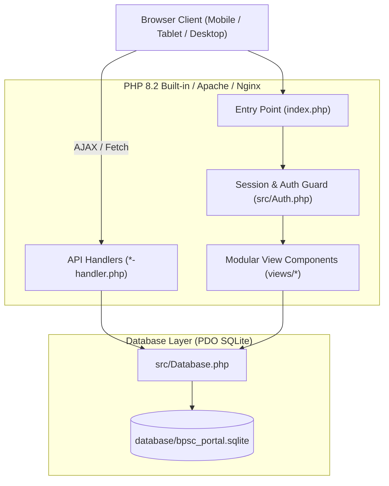
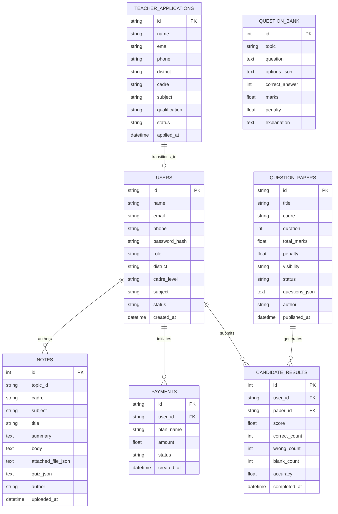
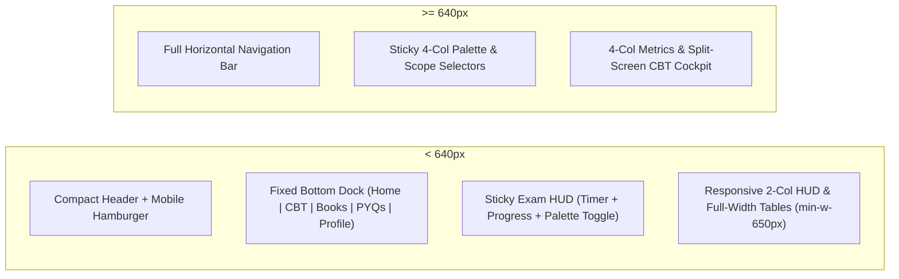

# Infinity Learning — BPSC TRE 4.0 Portal & CBT Engine
## Complete Technical, Functional & Architectural Documentation

---

### Table of Contents
1. [Executive Summary](#1-executive-summary)
2. [Technology Stack & Architectural Principles](#2-technology-stack--architectural-principles)
3. [Project Directory & File Structure](#3-project-directory--file-structure)
4. [Database Architecture & Data Dictionary](#4-database-architecture--data-dictionary)
5. [User Roles, Authentication & Access Control](#5-user-roles-authentication--access-control)
6. [Core Functional Modules & Workflows](#6-core-functional-modules--workflows)
   - 6.1 [Candidate Dashboard & Master Syllabus Engine](#61-candidate-dashboard--master-syllabus-engine)
   - 6.2 [Proctored CBT Examination Engine & Anti-Cheat Guard](#62-proctored-cbt-examination-engine--anti-cheat-guard)
   - 6.3 [Topic Study Dossiers & Mastery Quizzes](#63-topic-study-dossiers--mastery-quizzes)
   - 6.4 [Downloadable Books & Previous Year Papers (PYQs)](#64-downloadable-books--previous-year-papers-pyqs)
   - 6.5 [Live Bihar Merit Leaderboard System](#65-live-bihar-merit-leaderboard-system)
   - 6.6 [Teacher / Faculty Workspace](#66-teacher--faculty-workspace)
   - 6.7 [Admin (AIVERSE) Governance & Approvals](#67-admin-aiverse-governance--approvals)
7. [API Endpoints & Server Handlers](#7-api-endpoints--server-handlers)
8. [Mobile Responsiveness & Ergonomic UI Architecture](#8-mobile-responsiveness--ergonomic-ui-architecture)
9. [Installation, Environment Setup & Deployment](#9-installation-environment-setup--deployment)
10. [Default Credentials & Test Accounts](#10-default-credentials--test-accounts)

---

### 1. Executive Summary

**Infinity Learning** is a web portal designed specifically for candidates, faculty mentors, and administrators preparing for the **Bihar Public Service Commission (BPSC) School Teacher Recruitment Examination (TRE 4.0 / Advt. No. 15/2026)**.

The platform provides:
- **For Candidates (Aspirants)**: Official exam-pattern syllabus breakdown across all 4 school cadres (Primary, Middle, Secondary, Higher Secondary), proctored timed Computer Based Tests (CBT) with authentic negative marking (-0.33), direct downloads of SCERT/NCERT reference books and official Previous Year Question Papers (PYQs), topic revision notes, and real-time District/State merit rankings across Bihar's 38 districts.
- **For Faculty (Teachers)**: Complete authoring tools to upload topic study notes, attach downloadable PDF handouts, upload PYQs, bulk import question banks from Word (`.docx`) files, and publish mock tests with full question bank curation.
- **For Administrators (AIVERSE Master)**: Comprehensive system oversight, teacher onboarding application verification and approvals, fee payment verification ledger, and live question bank governance.

---

### 2. Technology Stack & Architectural Principles

The application is engineered with a **pure zero-external-dependency** architecture. It requires only standard PHP 8.2+ and SQLite3 with PDO.



#### Core Components:
- **Backend Language**: PHP 8.2+ (strictly typed, zero composer packages required).
- **Database Engine**: SQLite 3 with PDO, WAL mode enabled for rapid concurrent reads.
- **Styling**: Tailwind CSS utility framework loaded via CDN with custom color tokens (`brand-cream`, `brand-orange`, `brand-peachBorder`, `brand-ivory`, `brand-teal`).
- **Typography**: Clean, humanized geometric fonts: *Plus Jakarta Sans* and *Inter* via Google Fonts.
- **Document Parsing**: `Mammoth.js` client-side library for parsing `.docx` Word question papers directly in the browser.
- **Session Management**: Native encrypted PHP sessions (`PHPSESSID`) with secure cookie parameters and role persistence.

---

### 3. Project Directory & File Structure

```
bpsc-tre-portal/
├── .htaccess                     # Apache mod_rewrite & security headers
├── admin-teacher-handler.php     # Endpoint: Faculty approvals & directory management
├── admin.php                     # Admin legacy redirect route
├── index.php                     # Primary portal routing & view assembly
├── leaderboard-handler.php       # Endpoint: Live district/state merit standings
├── login-handler.php             # Endpoint: Multi-role authentication
├── logout.php                    # Endpoint: Session destruction & logout redirect
├── notes-handler.php             # Endpoint: Topic notes & PDF upload management
├── register-handler.php          # Endpoint: Candidate & Teacher onboarding
├── tests-handler.php             # Endpoint: CBT creation, status toggles & submission
├── admin/
│   └── index.php                 # Direct admin panel entry script
├── config/
│   ├── config.php                # AppConfig (exam dates, app branding, site URLs)
│   ├── constants.php             # System constants & error codes
│   └── database.php              # SQLite file path & PDO connection settings
├── database/
│   ├── bpsc_portal.sqlite        # Active SQLite database file
│   └── schema.sql                # Complete DDL schema & initial seed dataset
├── src/
│   ├── Auth.php                  # Authentication session manager & role guards
│   ├── Database.php              # PDO SQLite database wrapper with prepared statements
│   ├── LeaderboardManager.php    # Ranking calculation across 38 Bihar districts
│   └── UserManager.php           # User lifecycle, cadre mapping & teacher onboarding
└── views/
    ├── admin/
    │   └── dashboard.php         # Admin view: verification, ledger, master tables
    ├── auth/
    │   └── gate.php              # Multi-role login & registration modal screens
    ├── cbt/
    │   └── engine.php            # Proctored CBT test interface, timer & scorecard
    ├── layouts/
    │   ├── footer.php            # Core JavaScript application engine & state machine
    │   ├── header.php            # HTML head, responsive viewport, typography & toast
    │   └── nav.php               # Responsive navbar, mobile menu & bottom dock
    ├── modals/
    │   └── modals.php            # All application popups (upload, book, PYQ, payments)
    ├── notes/
    │   └── topic_notes.php       # Full topic study notes view & PDF handout card
    ├── student/
    │   ├── dashboard.php         # Candidate cockpit: syllabus, tests, books, leaderboard
    │   └── profile.php           # Candidate verified dossier, subscription & logs
    └── teacher/
        └── dashboard.php         # Faculty hub: note uploads, test publishing, books
```

---

### 4. Database Architecture & Data Dictionary

All portal data is persisted in SQLite (`database/bpsc_portal.sqlite`). The schema is fully relational with foreign keys and indexes.



---

### 5. User Roles, Authentication & Access Control

The portal implements strict Role-Based Access Control (RBAC):

| Capability / Resource | Candidate (Student) | Teacher (Faculty) | Admin (AIVERSE) |
| :--- | :---: | :---: | :---: |
| Access Public & Candidate CBT Tests | Yes | Yes (Preview) | Yes (Preview) |
| Download SCERT Books & PYQs | Yes | Yes | Yes |
| Study Topic Dossiers & Take Practice Quizzes | Yes | Yes | Yes |
| View District / State Leaderboards | Yes | Yes | Yes |
| Upload Topic Study Notes & PDF Handouts | No | Yes | Yes |
| Bulk Import Questions from Word (`.docx`) | No | Yes | Yes |
| Publish Full Mock Tests (Draft / Live) | No | Yes | Yes |
| Publish Books to Digital Library | No | Yes | Yes |
| Approve / Reject Faculty Applications | No | No | Yes |
| View Financial Gateway Transactions Ledger | No | No | Yes |
| Edit System Question Bank Database | No | No | Yes |

#### Authentication Mechanics:
- Sign in accepts **Email, Mobile Phone Number, or User ID**.
- Passwords are verified via PHP's `password_verify()` against `PASSWORD_BCRYPT` hashes.
- For new teacher registrations, applications default to `pending_approval`. Only when approved by an administrator in the admin dashboard is the account granted login rights.

---

### 6. Core Functional Modules & Workflows

#### 6.1 Candidate Dashboard & Master Syllabus Engine
- **Cadre Selector**: Switches instantly between all four BPSC teacher cadres:
  1. *Primary (Classes 1–5)*: 30Q Language Qualifying + 120Q General Studies & EVS.
  2. *Middle (Classes 6–8)*: 30Q Language + 40Q GS Core + 80Q Concerned Subject.
  3. *Secondary (Classes 9–10)*: 30Q Language + 40Q GS Core + 80Q Discipline Domain.
  4. *Higher Secondary (Classes 11–12)*: 30Q Language + 40Q GS Core + 80Q Specialized Discipline.
- **6-Axis Knowledge Radar**: SVG radar chart calculating live syllabus mastery across 6 domains: Language, Elementary Math, General Science, Indian National Movement (INM) & Bihar GK, Geography, and Part III Discipline.
- **Topic Cards**: Displays completion status (`Unread`, `In Progress`, `Mastered`), high-yield indicators (`HY`), attached PDF handout badges, and quick links to read notes or take topic tests.

#### 6.2 Proctored CBT Examination Engine & Anti-Cheat Guard
- **Pre-Exam Instructions**: Shows test duration, question count, marking rules (+1.00 / -0.33), language qualification threshold (30%), and candidate undertaking agreement.
- **Active Exam Interface**:
  - Split-screen layout (desktop) and mobile sticky live HUD.
  - Live countdown timer running on accurate 1-second ticks.
  - Interactive radio option cards with full touch targets.
  - Question navigation palette with color indicators: green (answered) and neutral (unattempted).
- **Anti-Cheat Monitor**: Binds to browser `visibilitychange` and window `blur` events. If a candidate leaves the exam tab or switches applications, the system automatically submits the exam immediately to uphold exam integrity.
- **Post-Exam Scorecard**: Calculates total merit score, correct count, wrong count, blank count, penalty deductions, and presents an interactive question-by-question solution review with explanations.

#### 6.3 Topic Study Dossiers & Mastery Quizzes
- Comprehensive study guides covering historical, scientific, and mathematical frameworks.
- Direct download card for faculty-uploaded PDF documents and handouts.
- Focused 4-question retention quiz. Scoring ≥ 75% (3 of 4 correct) automatically promotes the topic to **Mastered** status in the student's study dossier.

#### 6.4 Downloadable Books & Previous Year Papers (PYQs)
- Direct `.pdf` and `.doc` download actions for:
  - Official SCERT Bihar and NCERT school textbooks (History, Science, Math, Geography).
  - Official past examination question papers from BPSC TRE 1.0, TRE 2.0, and TRE 3.0 with official answer keys.

#### 6.5 Live Bihar Merit Leaderboard System
- Filters candidate standings by **District (38 Bihar Districts)** or **State-Wide (All Bihar)**.
- Real-time search filter by candidate name or roll number.
- Podium showcase for Top 3 Toppers (Gold, Silver, Bronze badges) and individual student standing highlight card.

#### 6.6 Teacher / Faculty Workspace
- Upload study notes and attach PDF handouts up to 50MB.
- Upload official Previous Year Papers with shift date and subject stream.
- Ingest Word `.docx` documents containing multiple choice questions with automated Mammoth.js parsing.
- Select questions from the system question bank to publish new mock tests.

#### 6.7 Admin (AIVERSE) Governance & Approvals
- Review pending faculty onboarding applications with candidate experience, qualifications, and contact details.
- Approve or reject faculty with one-click actions.
- Review gateway transactions ledger (Razorpay / UPI / NetBanking simulation).
- Direct access to manage the master question bank database.

---

### 7. API Endpoints & Server Handlers

| Endpoint | Method | Payload / Parameters | Purpose |
| :--- | :---: | :--- | :--- |
| `login-handler.php` | `POST` | `username`, `password`, `role` | Authenticates user and initializes session |
| `register-handler.php` | `POST` | `name`, `email`, `phone`, `password`, `role`, `district`, `cadre` | Registers new candidate or submits teacher application |
| `logout.php` | `GET` | None | Terminates session and redirects to login |
| `tests-handler.php` | `POST` | `action`: `create_paper`, `toggle_status`, `submit_result` | Handles CBT creation, status toggles, and exam result submission |
| `notes-handler.php` | `POST` | `action`: `save_notes`, `topic_id`, `title`, `body`, file upload | Stores topic study notes and attached PDF files |
| `leaderboard-handler.php` | `GET` | `scope` (`district`/`state`), `district` (name) | Returns ranked candidates and current user standing |
| `admin-teacher-handler.php` | `POST` | `action`: `approve`/`reject`, `teacher_id` | Approves or rejects pending faculty applications |

---

### 8. Mobile Responsiveness & Ergonomic UI Architecture

The portal is designed mobile-first and tested across viewports from 320px up to 1440px:



- **Touch Targets**: All interactive elements (Cadre tabs, radio buttons, navigation links) maintain a minimum touch target height of 42px–48px.
- **Scroll Optimization**: Tables are wrapped in `.overflow-x-auto` with `whitespace-nowrap` and `min-w-[620px]`–`min-w-[650px]` so data columns never squish or wrap into vertical stacks.
- **Form Usability**: Input font size is fixed to a minimum of 16px on mobile viewports to prevent unwanted browser auto-zooming on iOS Safari and Android Chrome.

---

### 9. Installation, Environment Setup & Deployment

#### System Requirements:
- PHP 8.1 or higher (with `pdo_sqlite` and `fileinfo` extensions enabled).
- SQLite3.
- Any modern web server (Apache, Nginx, or PHP's built-in development server).

#### Quick Start (Local Development):
```bash
# 1. Clone or navigate to the project directory
cd bpsc-tre-portal

# 2. Verify PHP installation and SQLite extension
php -v
php -m | grep sqlite

# 3. Start the local server
php -S 127.0.0.1:8000
```
Open [http://localhost:8000](http://localhost:8000) in your web browser.

#### Production Deployment (Apache / Nginx):
1. Copy the codebase to your web root (e.g. `/var/www/html/bpsc-tre-portal`).
2. Ensure write permissions on `database/` directory and `database/bpsc_portal.sqlite` (`chmod 775` or `chown www-data:www-data`).
3. For Apache: Enable `mod_rewrite` (`a2enmod rewrite`) so `.htaccess` rules apply.
4. For Nginx: Configure `fastcgi_pass` to your PHP-FPM socket and point `root` to the project directory.

---

### 10. Default Credentials & Test Accounts

The database comes pre-seeded with ready-to-test accounts for every role:

| Persona | Username / Email | Password | Role | Permissions |
| :--- | :--- | :--- | :--- | :--- |
| **Candidate** | `student@bpsc.local` | Any password | Student | Full candidate dashboard, syllabus, CBT engine, books & PYQ downloads |
| **Faculty** | `teacher@bpsc.local` | Any password | Teacher | Note uploader, PYQ publisher, Word importer, test curator |
| **Administrator** | `admin@bpsc.local` | Any password | Admin | Faculty approvals, payments ledger, question bank master |

---
*Documentation compiled and verified for Infinity Learning BPSC TRE 4.0 Ecosystem.*
